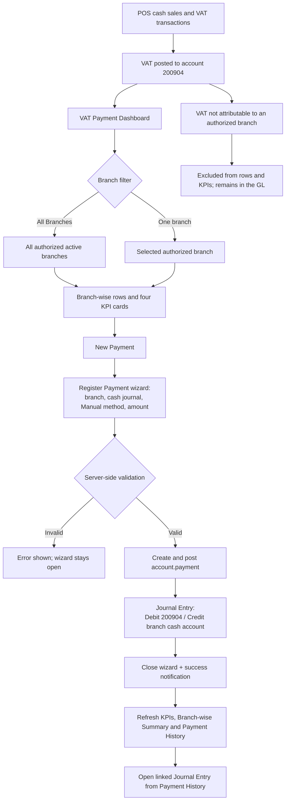
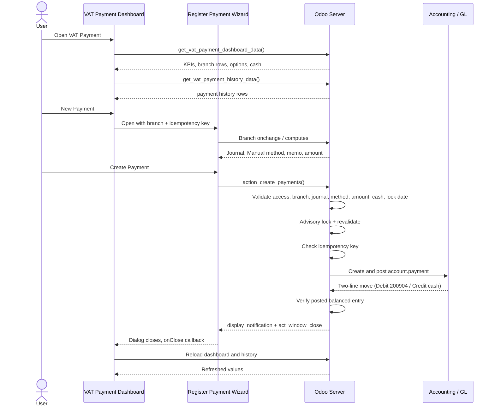
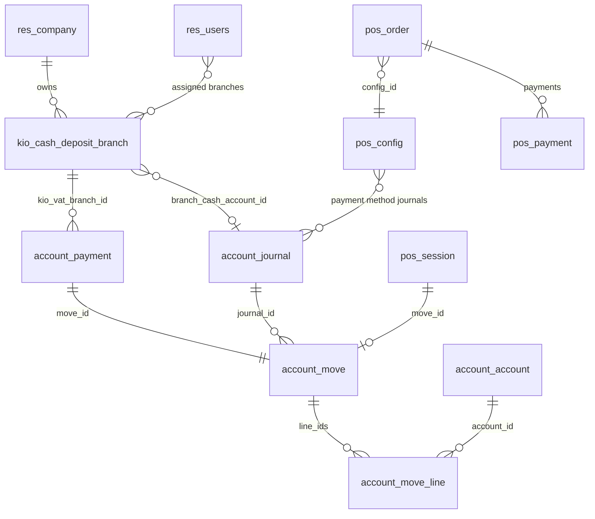

# KIO VAT Submission Extension

Professional and technical documentation for the Odoo 17 module
`kio_vat_submission_extension`.

| Item | Value |
| --- | --- |
| Module technical name | `kio_vat_submission_extension` |
| Application | Cash Deposit / VAT Payment |
| Odoo version | 17.0 |
| Module version | `17.0.1.0.0` |
| Direct dependency | `kio_cash_deposit` |
| Author | Kendroo Limited |
| License | OPL-1 |
| Repository path | `custom_addons/westeen-server/custom-addons/kio_vat_submission_extension` |

> The manifest's short `summary` and `description` still describe the module's
> original two-card scope. This README documents the complete implementation as
> it exists in the source code, including the VAT Payment dashboard, the
> validated VAT settlement workflow, Payment History, and the related
> accounting integration.

---

## Table of Contents

1. [Module Overview](#1-module-overview)
2. [Key Features](#2-key-features)
3. [Business Workflow](#3-business-workflow)
4. [VAT Calculation Logic](#4-vat-calculation-logic)
5. [VAT Payment Workflow](#5-vat-payment-workflow)
6. [Accounting Integration](#6-accounting-integration)
7. [Branch-wise Management](#7-branch-wise-management)
8. [User Roles and Permissions](#8-user-roles-and-permissions)
9. [Installation](#9-installation)
10. [Configuration](#10-configuration)
11. [Technical Architecture](#11-technical-architecture)
12. [Validation and Error Handling](#12-validation-and-error-handling)
13. [Testing](#13-testing)
14. [Known Limitations](#14-known-limitations)
15. [Module Information](#15-module-information)

---

## 1. Module Overview

### 1.1 What this module is

`kio_vat_submission_extension` extends the **KIO Cash Deposit** application
(`kio_cash_deposit`) in Odoo 17. It adds:

- Two sales/VAT KPI cards to the existing **Cash Deposit** dashboard.
- A dedicated **VAT Payment** dashboard with branch-wise VAT liability,
  settlement, cash-balance and payment-history reporting.
- A validated VAT settlement workflow built on the standard
  `account.payment.register` wizard and the standard `account.payment` model.
- A **Payment History** menu and a dashboard **Payment History** tab.
- VAT-specific journal-item labels and posted-payment safeguards.

The module is implemented entirely as an extension. It does **not** modify
`kio_cash_deposit`, standard Odoo accounting code, account types, existing
journal entries, or the base cash-balance calculation.

### 1.2 Business problems it solves

| Business problem | How this module addresses it |
| --- | --- |
| VAT liability is spread across branches and difficult to see | Branch-wise VAT summary with payable, paid, outstanding and actual cash balance |
| Users cannot tell how much VAT has actually been settled | Total Paid VAT and Outstanding VAT KPIs, derived from marked settlement payments |
| VAT payments are made from the wrong journal or bank account | The wizard automatically selects the branch's configured cash journal and Manual outbound method |
| Duplicate clicks create duplicate payments | Server-side idempotency key, unique constraint and branch-scoped advisory lock |
| Payments are posted but cannot be traced back to an entry | Payment History tab with clickable Journal Entry references |
| Unallocated VAT distorts branch totals | Unattributable VAT is excluded from rows and KPIs without altering the ledger |
| Cash impact of VAT is unclear | Current Cash Balance KPI from the actual GL cash journals; posted VAT reduces cash exactly once |
| Users are sent away from the dashboard after paying | The wizard closes in place and the dashboard refreshes through its close callback |

### 1.3 Key business benefits

- **Single source of truth:** one dashboard for VAT payable, paid, outstanding
  and cash by branch.
- **Branch accountability:** each branch's liability and settlement are visible
  separately, with an "All Branches" consolidated view.
- **Cash-aware payments:** VAT can only be paid from the branch's own cash
  journal with sufficient balance.
- **Auditability:** every settlement is a posted `account.payment` with a
  linked `account.move`, a branch, an idempotency key and descriptive journal
  item labels.
- **Safety:** server-side validation, atomic posting, duplicate protection and
  posted-payment protection.
- **No core modifications:** all behavior is isolated in this module; standard
  customer/vendor payments keep their normal behavior.
- **Role-aware visibility:** Cash Deposit managers see only their assigned
  branches; admins see all active branches in the current company.

### 1.4 Supported version and scope

- **Odoo 17.0** (the code uses Odoo 17 APIs, OWL, `account.payment.register`
  and `account.payment` behavior).
- The module is designed for **company-currency cash VAT settlements** from
  configured **cash** journals.
- It is a reporting and settlement extension, not a tax-filing engine. It does
  not submit returns to a tax authority and does not generate a challan.

---

## 2. Key Features

### 2.1 Feature status

| Feature | Status | Where implemented |
| --- | --- | --- |
| Cash Deposit dashboard sales/VAT KPI cards | Implemented | `models/cash_deposit.py`, `static/src/js/cash_deposit_dashboard_extension.js`, XML/SCSS |
| VAT Payment dashboard | Implemented | `static/src/js/vat_payment_page.js`, XML/SCSS, client action |
| Total VAT Payable KPI | Implemented | `_get_vat_branch_summary_data()` |
| Total Paid VAT KPI | Implemented | `_get_vat_branch_summary_data()` |
| Outstanding VAT KPI | Implemented | `_get_vat_branch_summary_data()` |
| Current Cash Balance KPI | Implemented | `_get_vat_current_cash_balance()` |
| Branch-wise VAT summary | Implemented | `_get_vat_branch_summary_data()` |
| Branch-wise cash balance | Implemented | Per-row `current_cash_balance` |
| Branch and date filtering | Implemented with documented semantics | RPC + frontend filters |
| Search and Reset Filters | Implemented | RPC + frontend |
| VAT payment registration | Implemented | `account_payment_register.py` |
| Payment History tab | Implemented | `get_vat_payment_history_data()` + OWL |
| Clickable Journal Entry references | Implemented | `openJournalEntry()` |
| Automatic dashboard refresh | Implemented | Wizard close callback |
| VAT-specific journal item labels | Implemented | `_get_liquidity_aml_display_name_list()` / `_get_counterpart_aml_display_name_list()` |
| Unallocated VAT exclusion | Implemented | `_get_vat_branch_summary_data()` |
| Duplicate prevention / idempotency | Implemented | Wizard + `account.payment` unique key |
| Posted VAT payment protection | Implemented | `write`/`unlink`/`action_cancel`/`action_draft` guards |
| Reversal workflow | **Not implemented** | Documented limitation |
| VAT authority partner / challan number | **Not configured / not implemented** | Documented limitation |
| Manual allocation of unallocated VAT to a branch | **Not implemented** | Documented limitation |
| Pagination/export in the dashboard history tab | **Not implemented** | Documented limitation |

### 2.2 Cash Deposit dashboard KPI cards

The module patches the existing Cash Deposit dashboard without changing the base
module:

- **Total Sales Amount** — sales excluding VAT attributable to cash still held.
- **Total VAT** — VAT attributable to that same remaining cash.
- **Current Cash Balance** — the existing base card, unchanged.

The three cards are kept in one horizontal row on desktop (the two new cards are
inserted immediately before the existing balance card). Card design, colors and
spacing are inherited from the base dashboard's
`.kio-cash-deposit__balance-card` styles. The KPI values come from the overridden
`get_cash_deposit_dashboard_data()` RPC.

These two cards are **not** a simple period total. They use a FIFO cash
allocation model so that only sales/VAT still represented by cash in the branch
are shown. The full formula is in
[Section 4.11](#411-cash-deposit-sales-and-vat-kpis-fifo-model).

### 2.3 VAT Payment dashboard

The **VAT Payment** menu opens the OWL client action
`kio_vat_submission_extension.vat_payment_page`. It contains:

- Title **VAT Payment** and a **+ New Payment** button.
- Four equal-width KPI cards in one row.
- A filter toolbar.
- Two tabs: **Branch-wise Summary** and **Payment History**.

### 2.4 The four KPI cards

| Card | Source field | Meaning |
| --- | --- | --- |
| **Total VAT Payable** | `total_payable` | Cumulative VAT credits recognized on account `200904`, net of non-settlement debits, for the visible branches |
| **Total Paid VAT** | `total_paid` | VAT settled through posted, marked VAT payments, for the visible branches |
| **Outstanding VAT** | `outstanding` | `total_payable - total_paid` for the visible branches |
| **Current Cash Balance** | `current_cash_balance` | Actual GL balance of the authorized branches' cash journals |

All four cards use the same layout, the company currency symbol (BDT in this
installation), and money formatting with two decimals. The **Current Cash
Balance** card uses:

- blue top border (`--kio-vat-blue`),
- `fa fa-money` icon,
- blue icon color on a light blue background.

On narrower screens the cards wrap to two columns and then one column.

The four cards are exactly the values calculated by the backend; the frontend
does not calculate VAT or cash independently.

### 2.5 Branch-wise Summary tab

Columns:

| Column | Backend field | Notes |
| --- | --- | --- |
| Branch | `branch` | Display name of an actual configured branch |
| Total VAT Payable | `total_payable` | Net recognized VAT for that branch |
| Paid VAT | `paid_vat` | Marked posted settlements for that branch |
| Outstanding VAT | `outstanding_vat` | `total_payable - paid_vat` |
| Current Cash Balance | `current_cash_balance` | Actual GL cash balance of the branch cash journal, or `0.0` when no valid cash journal is configured |
| Status | `status` / `status_key` | Settled, Partial or Unpaid |

The table includes a total row. The three VAT KPI cards equal the sum of the
visible branch rows by construction. The cash total is the distinct-journal GL
total, so if two branches deliberately share one cash journal, each row shows
that journal's full balance while the total (and KPI) counts the journal only
once.

Only **actual authorized, active branches of the current company** are shown.
There is no synthetic "Unallocated VAT" row.

### 2.6 Branch and date filtering

The filter toolbar contains:

- **Branch** — defaults to **All Branches**; options come from the existing
  `kio.cash.deposit.get_cash_deposit_branch_options()` RPC.
- **Date From**.
- **Date To**.
- **Search**.
- **Reset Filters**.

Behavior that is important to understand:

- **Branch** narrows the summary rows, the VAT KPIs, the cash KPI and Payment
  History to that branch. "All Branches" uses all authorized branches.
- **Date To** limits VAT/GL lines to `date <= date_to`.
- **Date From** is accepted by the RPC but is **not applied to the VAT summary**
  in the current implementation. The VAT summary is cumulative up to Date To, so
  opening liabilities and settlements are not lost. Date From **is** applied to
  the Payment History query.
- **Search** is applied to branch names before rows are appended. Consequently,
  it also narrows the VAT totals to the matching visible rows.
- The **Current Cash Balance** is independent of both date filters and the
  search box; it is the current GL cash balance.
- An invalid or unauthorized branch id submitted by a client is normalized to
  "All Branches" by `get_vat_payment_dashboard_data()`.

Every filter change calls both dashboard RPCs. **Reset Filters** clears branch,
dates and search and reloads the dashboard.

### 2.7 VAT payment registration

The **+ New Payment** button opens the standard Odoo Register Payment form
(`account.payment.register`, `target="new"`) with a module-specific context
flag. In that context:

- The standard wizard can open without invoice or journal-item lines.
- The **Branch** field is visible and required.
- The branch's configured cash journal is selected automatically.
- The configured **Manual** outbound payment method is selected automatically.
- The amount defaults to the branch's outstanding VAT.
- The memo is `VAT Payment - <Branch Name>`.
- The **Recipient Bank Account** field is hidden.
- Submitting runs the validated VAT posting workflow.

Standard invoice/journal-item Register Payment behavior is untouched: without
the dashboard context, the wizard routes to `super().action_create_payments()`.

### 2.8 Payment History tab

The dashboard tab is backed by `get_vat_payment_history_data()`. Its columns are:

| Column | Notes |
| --- | --- |
| Payment Reference | `account.payment.name` |
| Payment Date | ISO date string returned by the RPC |
| Branch | Branch name |
| Payment Amount | Company currency symbol plus two decimals |
| Journal Entry | Clickable `account.move.name`; `—` when no move exists |
| Status | Draft / Posted / Cancelled label |

The tab intentionally has **no Challan Number column** and **no Payment Journal
column**. The RPC still returns `journal` and a reserved empty `challan` value
for compatibility, but the tab does not display them.

The query is scoped to marked KIO VAT payments only, for the current company and
the caller's authorized branches. It supports branch, date-from/date-to and
search filters (search matches payment `name` or `ref`). The result limit is 100
rows by default and is clamped to 1–200; the tab has no pagination.

The workflow always posts the payment it creates, so rows normally show
**Posted**. The query itself does not filter by state, so any marked draft or
cancelled record would still be returned with its status.

### 2.9 Payment History menu

A separate **Payment History** menu opens a standard `account.payment`
window action:

- Domain: `[('is_kio_vat_payment', '=', True)]`.
- Search view: `account.view_account_payment_search`.
- Tree view: `account.view_account_payment_tree`.
- Form view: `account.view_account_payment_form`.

The standard tree view is inherited only to add a **Branch** column. That column
is invisible outside the VAT history context, so ordinary customer/vendor
payment lists are unchanged.

The action sets `context={'kio_vat_payment_history': True}`. On the server,
`AccountPayment._search()` re-applies the company scope and, for managers, the
assigned-branch scope. The browser cannot widen the history by editing the
action domain.

Unlike the dashboard tab, this menu is the standard payment list/form. It keeps
Odoo's normal search, filters, grouping, sorting and pagination, and it can open
the payment form subject to standard accounting access rights.

### 2.10 Clickable Journal Entry references

The dashboard's **Journal Entry** cell uses the existing linked
`account.payment.move_id` (and `move.name`). It does not create a new journal
entry.

- **Administrators (`base.group_system`):** Clicking the reference calls
  `kio.cash.deposit.action_open_vat_journal_entry(move_id)` and opens the
  standard Journal Entry form (`account.view_move_form`) for that move in the
  current window.
- **Branch Inventory Users (`kio_branch_inventory.group_branch_inventory_user`):**
  The Journal Entry reference (`move_name`) is displayed as plain,
  non-clickable text. `get_vat_payment_history_data()` omits `move_id`
  (`False`) and sets `can_open_journal_entry = False`, and direct RPC calls to
  `action_open_vat_journal_entry()` raise `AccessError` on the backend.
- If the payment has no linked move, the cell shows `—` and is not clickable.

### 2.11 Automatic dashboard refresh

After the Register Payment dialog closes, the dashboard reloads:

- all four KPI cards,
- the Branch-wise Summary tab,
- the Payment History tab.

The refresh is driven by the `onClose` callback passed to `doAction()`, because
in Odoo 17 `doAction()` for a `target="new"` dialog resolves when the dialog is
mounted, not when it closes. No full browser reload is performed.

Because the component state is not reset, the selected branch, date filters,
search text and active tab are preserved. The callback also runs when the dialog
is cancelled. A server validation error keeps the dialog open, so no refresh is
triggered in that case.

The same refresh happens on every filter change and on **Reset Filters**.

### 2.12 VAT-specific journal item labels

Both journal items of a VAT settlement use:

```text
VAT Payment - {Branch Name} - {DD/MM/YYYY}
```

Example:

```text
VAT Payment - W-16 JOYDEVPUR - 19/11/2026
```

The label is produced from the actual selected branch (`display_name`) and the
actual payment date. It is applied while the move lines are built, before
posting, and remains on the posted entry. It applies only when
`is_kio_vat_payment` is true and a branch is set. Standard vendor and customer
payments keep Odoo's normal labels.

### 2.13 Duplicate prevention and posted-payment safety

- A fresh idempotency key is generated each time the wizard is opened.
- A double click inside the same dialog reuses the key and returns the already
  created payment instead of creating another one.
- The key is stored in `kio_vat_idempotency_key`, which has a unique SQL
  constraint.
- A branch-scoped PostgreSQL transaction advisory lock serializes concurrent
  submissions for the same branch.
- Validation runs immediately before posting and again after the lock against
  freshly recomputed VAT and cash.
- Any failure rolls back the whole request, so no partial payment or partial
  journal entry remains.
- Posted VAT payments cannot be cancelled, reset to draft, deleted, or have key
  accounting-identity fields changed. There is no reversal workflow yet.

### 2.14 Access and multi-company behavior

- Cash Deposit dashboard RPCs call `_check_cash_deposit_access()`. VAT Payment
  RPCs instead require Administrator or Branch Inventory User membership.
- VAT Payment Administrators see all active branches in the current company.
- VAT Payment Branch Inventory Users see only the branches assigned to them through
  `res.users.kio_cash_deposit_branch_ids`.
- The branch field on `account.payment` uses `check_company=True`; validation
  rejects a branch from another company.
- The VAT Payable account is resolved per company.
- The Payment History action additionally scopes by `self.env.companies.ids` and
  applies the manager branch restriction server-side.
- Standard `account.payment` ACLs and multi-company record rules still apply.

### 2.15 Features that are not implemented

The following are deliberately **not** claimed as implemented:

- A VAT payment reversal/refund workflow.
- A configured VAT authority partner or challan-number field/workflow.
- Manual assignment of unallocated VAT to a branch.
- Pagination, export or printing on the dashboard Payment History tab.
- VAT payments from bank journals or in foreign currency.
- Automated tax-return filing or integration with a tax authority portal.
- A replacement for the standard Payment History list; the menu remains a
  standard `account.payment` list with a conditional Branch column.

---

## 3. Business Workflow

### 3.1 End-to-end flow

1. **VAT is collected in POS sales.** POS orders post their tax to the
   configured VAT Payable account (`200904` in this installation).
2. **VAT is attributed to a branch.** A move is attributed through a marked VAT
   settlement's branch, or — for tax moves — through the existing POS
   configuration → payment method → branch cash journal mapping.
3. **The VAT Payment dashboard aggregates the posted VAT lines.** It separates
   recognized VAT payable from settlement debits and calculates paid and
   outstanding amounts.
4. **The user selects a branch or All Branches.** Only authorized active
   branches of the current company are available.
5. **The user clicks New Payment.** The Register Payment wizard opens with the
   branch preselected if one was selected.
6. **The wizard selects the branch's cash journal and Manual method.** The
   amount defaults to the branch's outstanding VAT and remains editable for a
   partial payment.
7. **The server validates the request.** Access, branch, journal, method,
   currency, outstanding VAT, cash availability, VAT account and lock dates are
   checked.
8. **One outbound `account.payment` is created and posted.** Its move debits
   `200904` and credits the branch cash account.
9. **The wizard closes in place.** A success notification is shown and the user
   stays on the VAT Payment dashboard.
10. **The dashboard refreshes.** KPIs, branch summary and payment history are
    reloaded with the existing filters and active tab.
11. **The payment is traceable.** The Payment History tab shows the payment and
    a clickable Journal Entry reference.

### 3.2 Mermaid flowchart



### 3.3 Who does what

| Actor | Responsibility |
| --- | --- |
| Cash Deposit Manager | Monitors assigned branches, opens the dashboard, initiates VAT payments for assigned branches (if granted accounting payment rights) |
| Cash Deposit Admin | Monitors all active branches in the current company, configures branches and cash journals (base module ACLs apply) |
| Accounting user | Provides `account.payment` create/post rights and can inspect the resulting journal entry |
| System administrator | Installs/upgrades the module, configures the VAT account and ensures branch cash journals are valid |

---

## 4. VAT Calculation Logic

### 4.1 Data source for the VAT Payment dashboard

The VAT summary reads **posted** `account.move.line` records on the company's
VAT Payable account, excluding section/note lines:

```python
domain = [
    ("account_id", "=", vat_account.id),
    ("company_id", "=", company.id),
    ("parent_state", "=", "posted"),
    ("display_type", "not in", ("line_section", "line_note")),
]
```

If **Date To** is supplied, `date <= date_to` is added. **Date From is not
applied to this summary** (see Section 2.6).

The VAT account is found by `_get_vat_payable_account()`:

- code matches `200904%` (using `=like`),
- exact code `200904` is preferred when multiple accounts match,
- otherwise the first account in deterministic `code, id` order is used.

The account's type is **not changed** by this module. In this installation it is
`200904`, configured as a non-current liability and reconcile-enabled.

### 4.2 Total VAT Payable

For each posted VAT line that is **not** a marked settlement, the recognized
amount is:

```text
recognized = credit - debit
```

For branch `b`:

```text
P_b = Σ (credit - debit) for non-settlement VAT lines attributed to b
Total VAT Payable = Σ_b P_b
```

Interpretation:

- A VAT credit (normal output VAT) increases the payable.
- A VAT debit that is **not** a marked settlement (for example an adjustment,
  credit note, refund or manual correction) reduces the payable.
- A marked settlement debit does **not** reduce Total VAT Payable; it is
  reported as Paid VAT instead.
- The figure is cumulative up to Date To, not limited to a reporting period.

### 4.3 Total Paid VAT

Only posted payments explicitly marked as KIO VAT payments count as paid:

```text
settled = debit - credit

S_b = Σ (debit - credit) for settlement VAT lines attributed to b
Total Paid VAT = Σ_b S_b
```

A payment qualifies as a settlement only when:

- its move has a linked `account.payment`,
- `is_kio_vat_payment` is true,
- the payment state is `posted`.

An ordinary journal-entry debit to `200904` is therefore treated as a payable
adjustment, not as a VAT payment. This prevents unmarked entries from being
misreported as paid VAT.

### 4.4 Outstanding VAT

```text
O_b = P_b - S_b
Outstanding VAT = Total VAT Payable - Total Paid VAT
```

The total is the sum of the visible branch rows. The three VAT KPI cards are
therefore exactly equal to the sum of the visible rows:

```text
Total VAT Payable  = Σ row.total_payable
Total Paid VAT     = Σ row.paid_vat
Outstanding VAT    = Σ row.outstanding_vat
```

### 4.5 Current Cash Balance

The cash KPI is independent of VAT calculations. It reuses the base Cash
Deposit GL balance helper on the authorized branches' configured **cash**
journals:

```text
Current Cash Balance = Σ account_move_line.balance
    WHERE account_id IN (default_account_id of branch cash journals)
      AND company_id = current company
      AND display_type NOT IN ('line_section', 'line_note')
      AND parent_state != 'cancel'
```

Notes:

- Only journals of type `cash` contribute. Bank journals never contribute.
- All authorized branches are included for **All Branches**; selecting a branch
  restricts the calculation to that branch's journal.
- A branch without a valid cash journal contributes `0.0` to its row and to the
  total.
- Distinct journals are used for the total, so shared journals are not
  double-counted; each affected branch row still shows the full journal balance.
- The calculation uses the base module's behavior, which includes non-cancelled
  lines (draft and posted). It is not a posted-only balance.
- A posted VAT payment credits the branch cash account, so cash falls by the
  payment amount automatically. There is **no extra manual VAT deduction**.
- A bank payment does not touch a cash journal and therefore does not reduce the
  cash KPI.

### 4.6 Branch allocation of VAT lines

`_resolve_vat_move_branch_id()` resolves a VAT line to a branch in this order:

1. **Marked settlement:** if the move is linked to a posted marked VAT payment
   with a branch, use that branch.
2. **POS closing entry:** find `pos.session.move_id` and use its `config_id`.
3. **Linked POS orders:** collect `pos.order.config_id` through
   `move.pos_order_ids` (when the field exists) and through
   `pos.order.account_move`.
4. Convert config ids to branches using `_get_pos_config_branch_map()`:
   a POS config is attributed to a branch when the branch's cash journal is one
   of the config's payment method journals and exactly one authorized branch
   matches.
5. If exactly one branch is resolved, attribute the line to it.
6. Otherwise the line is **unallocated** and is excluded from the summary.

Ambiguous mappings are intentionally treated as unallocated rather than guessed.

### 4.7 Date and search behavior

- `date_to` filters VAT/GL lines and Payment History.
- `date_from` filters Payment History only; the VAT summary remains cumulative
  up to `date_to`.
- `search` filters the visible branch names in the summary; the totals include
  only the rows that remain visible. In Payment History, search matches
  `account.payment.name` or `ref`.
- Cash balance ignores all date/search filters and reflects the current GL
  balance.
- The GL reference value (`gl_outstanding`) also respects `date_to` but not
  `date_from`.

### 4.8 Row status logic

The status badge is derived from the row amounts using company-currency
rounding:

| Condition | Status |
| --- | --- |
| Outstanding, payable and paid are all approximately zero | Settled |
| Outstanding is approximately zero | Settled |
| Paid and outstanding are non-zero, and payable is zero or paid/payable have the same sign | Partial |
| Payable is zero or negative and paid is approximately zero | Settled |
| Paid is approximately zero and outstanding is non-zero | Unpaid |
| Any other combination | Unpaid |

The badge colors are green for Paid/Settled, orange for Partial and red for
Unpaid.

### 4.9 Refunds, adjustments and reversals

- A **VAT debit that is not a marked settlement** (credit note, adjustment,
  refund or manual correction) reduces Total VAT Payable through the
  `credit - debit` formula.
- A **marked posted payment** is recognized as Paid VAT through
  `debit - credit`.
- Standard POS refunds in the **Cash Deposit sales/VAT KPI** are handled by the
  FIFO model: a negative cash payment creates an outflow that consumes the
  oldest cash layers. It is not also subtracted as a negative sales layer, which
  prevents double counting.
- There is **no reversal workflow** for a posted VAT payment. Posted VAT
  payments cannot be cancelled, reset to draft, deleted, or have their
  accounting-identity fields changed. A future safe-reversal process would be a
  separate feature.

### 4.10 Unallocated VAT handling

VAT lines that cannot be attributed to a configured, authorized branch are
**skipped entirely** for reporting:

- they are not displayed as a row,
- they are not added to Total VAT Payable, Total Paid VAT or Outstanding VAT,
- they are not added to any branch row,
- their accounting records are not modified or deleted.

The GL reference `gl_outstanding` is still calculated across the **whole** VAT
account, so it can legitimately differ from Outstanding VAT when unallocated VAT
exists:

```text
GL outstanding = Σ (credit - debit) on account 200904 (posted, up to date_to)
```

`gl_outstanding` is returned by the RPC for reconciliation but is not displayed
on the dashboard. It includes unallocated VAT; Outstanding VAT does not.

### 4.11 Cash Deposit sales and VAT KPIs (FIFO model)

The two cards on the base Cash Deposit dashboard use a separate model. They
answer: *how much of the recorded POS sales and VAT is still represented by cash
in the branch's cash account?*

#### Eligible POS orders

```text
company_id = current company
state in (paid, done, invoiced)
session_id.state = closed
date_order <= end of today in company/user timezone
```

#### Cash-paid portion

For each eligible order, cash payments are summed only for payment methods whose
journal is one of the coverage cash journals:

```text
cash_paid_o = Σ pos.payment.amount
              WHERE payment method journal ∈ coverage cash journals

portion_o = cash_paid_o / amount_total_o

sales_layer_o = portion_o × (amount_total_o - amount_tax_o)
vat_layer_o   = portion_o × amount_tax_o
```

`amount_total` and `amount_tax` are Odoo's own POS-computed values, so product
discounts, multiple tax rates and tax-exempt lines are preserved. Linked
invoices are not read, which prevents double counting.

If `cash_paid_o > 0`, the order creates a positive sales layer. If
`cash_paid_o < 0`, the order is a cash refund and creates an outflow of
`abs(cash_paid_o)` instead of a negative sales layer.

#### FIFO allocation

Cash inflows are:

- opening/non-POS debits to the coverage cash accounts (non-sales layers),
- positive POS cash receipts (sales layers with their own sales/VAT).

Cash outflows are:

- non-POS credits to the coverage cash accounts, excluding approved Cash
  Deposit entries (transfers, expenses, VAT payments, refunds paid in cash),
- negative POS cash payments (refunds).

Approved Cash Deposits are identified through the `kio.cash.deposit` relational
records (manual deposits via `journal_entry_id`, POS-session deposits via
`pos_statement_line_id`). They are excluded from the generic outflow list and
are instead deducted from **Total Sales Amount only** after the FIFO allocation.
They never reduce **Total VAT**. Cancelled or reversed deposits are excluded.

POS accounting moves are excluded from the opening/outflow line sets using the
move ids of statement lines linked to POS sessions, so they are not counted
twice alongside `pos.payment` records.

Events are sorted by date, then priority, then id:

| Priority | Event |
| --- | --- |
| 0 | Opening/non-sales inflow |
| 1 | POS sales inflow |
| 2 | Outflow |

Each outflow consumes the oldest inflow with remaining cash first. For each
sales layer:

```text
f_o = remaining_cash_o / cash_paid_o

Total Sales Amount = Σ sales_layer_o × f_o  −  approved deposit total (capped at available Sales Amount)
Total VAT          = Σ vat_layer_o  × f_o
```

This is an allocation policy, not the accounting VAT balance. It is intended to
show the sales/VAT still backed by cash after withdrawals, deposits, expenses
and refunds.

#### Coverage scope

- Selected branches in the base dashboard → their configured cash journals.
- Admin with no selected branches → all company cash journals.
- Manager with no effective branch → no figures (zero), mirroring the base
  dashboard's cash behavior.
- Branch filtering applies to the coverage journals; company scoping always
  applies.

### 4.12 Worked examples

#### Example A — full and partial VAT settlement

Assumptions: Branch A has recognized VAT payable of `1,000.00`, no payments,
and `5,000.00` cash in its cash journal.

| Step | Total VAT Payable | Total Paid VAT | Outstanding VAT | Branch cash | GL 200904 outstanding |
| --- | ---: | ---: | ---: | ---: | ---: |
| Initial | 1,000.00 | 0.00 | 1,000.00 | 5,000.00 | 1,000.00 |
| Pay 250.00 | 1,000.00 | 250.00 | 750.00 | 4,750.00 | 750.00 |
| Pay remaining 750.00 | 1,000.00 | 1,000.00 | 0.00 | 4,000.00 | 0.00 |

The second payment is still an outbound payment of the same type; only the
amount differs. The branch status becomes **Settled**.

#### Example B — All Branches versus one branch

| Branch | Payable | Paid | Outstanding | Cash |
| --- | ---: | ---: | ---: | ---: |
| Branch A | 1,000.00 | 250.00 | 750.00 | 4,750.00 |
| Branch B | 500.00 | 0.00 | 500.00 | 2,500.00 |
| **All Branches** | **1,500.00** | **250.00** | **1,250.00** | **7,250.00** |

Selecting Branch A shows only its row and its KPI values. If A and B shared one
cash journal with a `4,750.00` balance, each row would show `4,750.00` but the
All Branches cash KPI would count that journal once.

#### Example C — unallocated VAT

A `300.00` VAT credit is posted on `200904` and cannot be attributed to any
authorized branch.

- Branch rows and all three VAT KPIs do not change.
- `gl_outstanding` increases by `300.00`.
- The accounting entry remains in the ledger; only reporting excludes it.

#### Example D — search narrowing

If the All Branches view has Branch A (`1,000.00`) and Branch B (`500.00`) and
the user searches for `A`, only Branch A is visible, so the KPI totals show
Branch A's amounts. This is the implemented behavior because search is applied
before rows and totals are accumulated.

### 4.13 Reconciliation rule

For a fully attributed ledger:

```text
GL outstanding (200904) = Total VAT Payable - Total Paid VAT
```

When unallocated VAT exists:

```text
GL outstanding = Outstanding VAT + unallocated VAT
```

This is expected. Use `gl_outstanding` from the RPC for reconciliation; do not
assume it must equal the displayed Outstanding VAT.

---

## 5. VAT Payment Workflow

### 5.1 Preconditions

Before a VAT payment can be posted:

1. The user has the Cash Deposit Manager group (`access` check).
2. The user has standard `account.payment` create rights.
3. The branch is active, authorized for the user and belongs to the payment
   company.
4. The branch has a configured cash journal
   (`branch.branch_cash_account_id`).
5. The journal is active, type `cash`, same company, and has no currency that
   conflicts with the company currency.
6. The journal has a **Manual** outbound payment method line.
7. The Manual method's payment/outstanding account equals the journal's default
   cash account.
8. The VAT Payable account (`200904`) exists, is not deprecated and belongs to
   the company.
9. The amount is greater than zero and does not exceed the branch's outstanding
   VAT.
10. The branch cash journal has enough balance.
11. The payment date is not inside a company accounting lock date.

### 5.2 Step-by-step

#### Step 1 — Open the VAT Payment Dashboard

Use **Cash Deposit → VAT Payment**. The page loads branch options, the branch
summary, the four KPI values and the payment history from the server.

#### Step 2 — Select a branch (optional)

Choose **All Branches** or a specific branch. The selection immediately reloads
the summary and history. If a branch is selected when the wizard opens, it is
passed as the default branch.

#### Step 3 — Click New Payment

The standard Register Payment form opens in a dialog with:

- `kio_vat_payment_dashboard` context,
- `default_kio_vat_branch_id` when a branch is selected,
- a fresh `kio_vat_payment_idempotency_key`.

#### Step 4 — Review the branch, journal and method

Selecting a branch triggers `_onchange_kio_vat_branch_id()`:

- unavailable branch → cleared with a warning,
- no valid cash journal → journal/method cleared, inline warning shown,
- valid journal → journal set, Manual outbound method set,
- memo set to `VAT Payment - <Branch>`,
- amount set to the branch's outstanding VAT.

Clearing the branch clears journal, method, memo, warning and amount.

#### Step 5 — Enter or adjust the amount

Full payment uses the prefilled amount. Partial payment uses a smaller positive
amount. The amount must not exceed outstanding VAT or available branch cash.

#### Step 6 — Create Payment

The server:

1. validates once for a clear error,
2. acquires the branch-scoped advisory lock,
3. revalidates against fresh data,
4. checks the idempotency key,
5. creates one outbound `account.payment`,
6. posts it,
7. verifies the resulting two-line balanced move,
8. returns the success action.

#### Step 7 — Wizard closes in place

The success action is an `ir.actions.client` notification with
`params.next = {"type": "ir.actions.act_window_close"}`. The payment form is not
opened and the user is not navigated away.

#### Step 8 — Dashboard refreshes

The dashboard's `onClose` callback reloads the four KPIs, Branch-wise Summary and
Payment History while preserving branch, dates, search and active tab.

#### Step 9 — Verify in Payment History

The new payment appears in the **Payment History** tab with its reference, date,
branch, amount, status and clickable Journal Entry.

#### Step 10 — Open the journal entry

Click the journal-entry reference to open the standard `account.move` form. The
entry is the existing move linked through `payment.move_id`; no duplicate entry
is created.

### 5.3 Mermaid sequence diagram



### 5.4 Success, cancel and error behavior

| Situation | Behavior |
| --- | --- |
| Successful posting | Success notification, wizard closes, dashboard refreshes, filters and tab preserved |
| Duplicate click with same key | Existing payment is returned with the same success notification; no second payment |
| Duplicate from a later wizard opening | A fresh key is generated, so an intentional same-amount payment is allowed if it still passes outstanding/cash validation |
| Validation error | `UserError` is raised; dialog stays open; no payment is created; no refresh |
| Posting or verification failure | Transaction rolls back; no partial payment or journal entry remains |
| Dialog cancelled | Close callback still refreshes the dashboard |
| Unauthorized user | `AccessError` / `UserError`; no payment |

---

## 6. Accounting Integration

### 6.1 Accounts and their roles

| Account | Role | Configured in |
| --- | --- | --- |
| `200904` VAT Payable | Debit side of a VAT settlement; source of the VAT payable balance | Company chart of accounts; resolved by code |
| Branch cash account | Credit side of a VAT settlement; also the branch's cash balance account | `account.journal.default_account_id` and the Manual method line's payment account |
| Company outstanding payments account | Only an acceptable fallback if it equals the journal's default cash account | Company accounting settings / payment method |
| Bank accounts | Never used by the VAT cash workflow | Not selected by the VAT wizard |

The module does **not** change the VAT account type. It reads the account and
uses it as the payment destination.

### 6.2 Journal selection

`_get_vat_branch_cash_journals()` reuses the existing branch-to-journal
relationship:

```text
kio.cash.deposit.branch.branch_cash_account_id → account.journal
```

A journal is accepted only when all of the following are true:

- the branch exists and is active,
- the branch belongs to the payment company,
- the journal is active,
- the journal type is `cash`,
- the journal belongs to the same company,
- the journal currency (if any) is compatible with the payment currency.

There is no name matching, no hardcoded journal id and no fallback to a bank
journal or another branch's cash journal.

### 6.3 Debit and credit construction

The workflow creates one outbound `account.payment` with:

```text
payment_type       = outbound
partner_type       = supplier
partner_id         = False
destination_account_id = 200904 (VAT Payable)
journal_id         = branch cash journal
payment_method_line_id = Manual outbound method line
amount             = validated amount
date               = payment date
ref                = VAT Payment - <Branch Name>
is_kio_vat_payment = True
kio_vat_branch_id  = selected branch
kio_vat_idempotency_key = SHA-256 key
```

Odoo builds the move lines through `_prepare_move_line_default_vals()`:

| Line | Account | Debit | Credit |
| --- | --- | ---: | ---: |
| Counterpart | `200904` VAT Payable | Amount | 0.00 |
| Liquidity | Branch cash account | 0.00 | Amount |

The payment move is `move_type = entry`, is linked through `payment.move_id`
(and `move.payment_id`), and contains exactly two lines for this workflow.

### 6.4 `account.payment` integration

- The standard `account.payment` model is extended, not replaced.
- `is_kio_vat_payment` is the technical marker.
- `kio_vat_branch_id` stores the branch.
- `kio_vat_idempotency_key` stores the deduplication key and has a unique SQL
  constraint.
- `_compute_destination_account_id()` first calls the standard computation, then
  overrides the destination only for marked VAT payments.
- `_search()` adds the Payment History scope only when the history context flag
  is present.
- Standard payment create/post behavior remains in use; the module adds
  validation around it rather than writing journal entries directly.

### 6.5 `account.move` integration

- The move is the standard move created by `account.payment`.
- It is posted with the standard `action_post()`.
- The module verifies:
  - `move.state == 'posted'`,
  - exactly two lines,
  - exactly one debit line on `200904`,
  - exactly one credit line on the branch cash account,
  - debit equals the amount,
  - credit equals the negative amount,
  - total balance is zero.
- The Payment History tab and menu use the existing move reference; no new move
  is created for history.

### 6.6 Journal item label format

Both lines use:

```text
VAT Payment - {branch.display_name} - {payment.date:%d/%m/%Y}
```

Implementation hooks:

```python
def _get_liquidity_aml_display_name_list(self):
    if self.is_kio_vat_payment and self.kio_vat_branch_id:
        return [("label", self._kio_vat_move_line_label())]
    return super()._get_liquidity_aml_display_name_list()

def _get_counterpart_aml_display_name_list(self):
    if self.is_kio_vat_payment and self.kio_vat_branch_id:
        return [("label", self._kio_vat_move_line_label())]
    return super()._get_counterpart_aml_display_name_list()
```

The label is built before posting because these hooks run while the move lines
are prepared during `account.payment.create()`. Posting does not rewrite it.
The label is limited to marked VAT payments with a branch; ordinary customer and
vendor payments keep Odoo's standard labels.

### 6.7 Practical journal entry example

Example: Branch `W-09 KHULNA`, cash account `1001017`, partial VAT payment of
`250.00 BDT` on `19/11/2026`.

```text
Payment:  PKLNA/2026/00001
Ref:      VAT Payment - W-09 KHULNA
Journal:  KLNA (cash)
Method:   Manual (outbound)
State:    Posted
```

| Account | Account name | Debit | Credit | Journal item label |
| --- | --- | ---: | ---: | --- |
| `200904` | VAT Payable | 250.00 | 0.00 | VAT Payment - W-09 KHULNA - 19/11/2026 |
| `1001017` | Branch cash account | 0.00 | 250.00 | VAT Payment - W-09 KHULNA - 19/11/2026 |

The exact account code and journal code depend on the live configuration. The
structure — debit `200904`, credit the branch cash account, two balanced lines —
is enforced by the workflow.

### 6.8 Settlement recognition after posting

`_kio_vat_settlement_payment()` looks for a linked `account.payment` through
`move.payment_id` or `move.payment_ids`, requires the VAT marker and a posted
state, and returns it. `_resolve_vat_move_branch_id()` then attributes the
settlement to `payment.kio_vat_branch_id` before falling back to POS mapping.

As a result:

- Total Paid VAT increases by the settlement debit.
- Outstanding VAT decreases by the same amount.
- Total VAT Payable is unchanged.
- Current Cash Balance decreases through the posted cash credit.
- GL outstanding decreases through the posted VAT debit.

### 6.9 Cancellation and reversal behavior

- `write()` blocks changes to key accounting-identity fields of a posted VAT
  payment when performed by a normal user (not `sudo`, and not the internal
  system-update context).
- `unlink()` blocks deletion.
- `action_cancel()` blocks cancellation.
- `action_draft()` blocks resetting to draft.

There is no safe reversal workflow yet. Corrections must be handled by an
authorized accounting process outside this module until a reversal feature is
implemented.

### 6.10 Standard payments are unaffected

The following are explicitly scoped:

- Destination account override: only for `is_kio_vat_payment`.
- Journal-item labels: only for `is_kio_vat_payment` with a branch.
- Wizard initialization and computes: only with `kio_vat_payment_dashboard`
  context and no `line_ids`.
- Create Payment routing: only with `kio_vat_payment_dashboard` context.
- Partner bank hiding: only in the dashboard context.
- Branch column: only in the VAT history context.

Ordinary vendor payments still use a standard payable destination and labels
such as `Vendor Payment ...`; ordinary customer payments are untouched.

---

## 7. Branch-wise Management

### 7.1 Authorized branch universe

`_get_authorized_vat_branches()` mirrors the Cash Deposit dashboard access
semantics:

| User type | Branch universe |
| --- | --- |
| Cash Deposit Admin | All active branches in the current company, ordered by sequence, name, id |
| Cash Deposit Manager | Active branches assigned through `res.users.kio_cash_deposit_branch_ids`, in the current company |
| User without Cash Deposit access | `AccessError` |

Branch options for the **All Branches** selector come from the base module's
`get_cash_deposit_branch_options()`. They include only actual active branches of
the current company (or the manager's assigned branches). There is no synthetic
branch row.

### 7.2 All Branches behavior

- The rows are all authorized branches.
- Each row shows that branch's VAT payable, paid, outstanding and cash balance.
- The three VAT KPIs are the sum of all visible rows.
- The cash KPI is the distinct-journal GL total of all authorized branch cash
  journals.
- Unallocated VAT is excluded.
- A search narrows the visible rows and therefore the totals.

### 7.3 Individual branch behavior

- The rows contain only the selected branch.
- The VAT KPIs contain only that branch.
- The cash KPI uses only that branch's configured cash journal.
- Payment History is restricted to that branch.
- The New Payment wizard preselects the branch.

### 7.4 Branch-wise VAT liability

VAT liability is recognized from posted `200904` lines attributed to the branch
using the rules in [Section 4.6](#46-branch-allocation-of-vat-lines). A branch
can have:

- payable only (no payments yet),
- payable and partial paid,
- fully settled,
- payable adjustments from credits/debits,
- zero activity.

### 7.5 Branch-wise payment allocation

A settlement is allocated to the branch recorded on the payment
(`payment.kio_vat_branch_id`). This is the authoritative allocation for payments
created by this module. The POS configuration mapping is a fallback for tax
moves; it is not used to reallocate an existing settlement.

### 7.6 Branch-wise current cash balance

Each branch row reads the balance of its own configured cash journal. If the
branch has no valid cash journal, the row shows `0.0`. Negative balances are
preserved and displayed accurately rather than being clamped.

When multiple branches share a cash journal, each row shows the full journal
balance, but the total/KPI deduplicates the shared journal.

### 7.7 Multi-company behavior

- Dashboard RPCs operate on `self.env.company`.
- Authorized branches are filtered by the current company.
- VAT account resolution is per company.
- The branch field on `account.payment` uses `check_company=True`.
- The payment workflow rejects a branch from another company.
- The Payment History action scopes by `self.env.companies.ids` and the
  standard `account.payment` company rules.
- Switching company changes the dashboard data.

### 7.8 Shared journals and no-journal branches

- A branch with no cash journal is still listed (as an authorized branch) with a
  zero cash balance and no valid journal for payment.
- The wizard shows a warning and disables journal selection for that branch.
- A shared journal is counted once in the aggregate cash KPI; each branch row
  reflects the journal's actual balance.

---

## 8. User Roles and Permissions

### 8.1 Security groups used

This module **does not define new security groups**. It reuses the existing Odoo
and branch inventory groups. It **does** define the ACL rows and the record rule
needed to scope Branch Inventory User access to their assigned branches:

| File | Purpose |
| --- | --- |
| `security/ir.model.access.csv` | Grants Branch Inventory User read access to `ir.model.data` (fixes the client-side `ir.model.data` AccessError when opening the wizard or a journal entry), and read/create access to `account.payment`, `account.move`, `account.move.line` and `account.payment.register` so the VAT payment workflow can run as the user. |
| `security/ir.rule.xml` | Record rule on `account.payment`: Branch Inventory User can only read/create VAT payments for their assigned Cash Deposit branches (`res.users.kio_cash_deposit_branch_ids`), in the current company. A user without an assigned branch matches no record. |

It retains the cash-deposit branch assignments to scope the dashboard data:

| Group | Technical id | Source | Meaning here |
| --- | --- | --- | --- |
| Administrator | `base.group_system` | Odoo base | Can access the menu and RPCs; sees active branches in the current company |
| Branch Inventory User | `kio_branch_inventory.group_branch_inventory_user` | `kio_branch_inventory` | Can access the menu and RPCs; branch results remain scoped to the user's assigned Cash Deposit branches |
| Cash Deposit Manager | `kio_cash_deposit.group_kio_cash_deposit_user` | `kio_cash_deposit` | Supplies existing branch assignments used to scope Branch Inventory User dashboard data; keeps pre-existing Payment History access |
| Billing / Accounting | `account.group_account_invoice` | Odoo accounting | Needed for standard `account.payment` create/post rights in many setups |

### 8.2 Capability matrix

| Capability | Administrator | Branch Inventory User | Other users |
| --- | --- | --- | --- |
| Open VAT Payment menu | Yes | Yes | No menu; RPC raises AccessError |
| View dashboard KPIs | All active branches in current company | Assigned branches | No |
| View Branch-wise Summary | All active branches | Assigned branches | No |
| View Payment History | All active branches | Assigned branches | No |
| Select a branch in the wizard | Any active branch in company | Only assigned | No |
| Create/post a VAT payment | Only if accounting payment rights are also granted | Only if accounting payment rights are also granted, and only for assigned branches | No |
| Configure branch cash journals | Yes, subject to base ACL | Subject to base ACL | No VAT dashboard access |
| Mark an arbitrary payment as VAT | Subject to existing payment authorization | Subject to existing payment authorization | No VAT dashboard access |
| Cancel/delete a posted VAT payment | No | No | No |
| Open linked journal entry | Subject to standard accounting access | Subject to standard accounting access | No |

### 8.3 Server-side enforcement

The menus are only the first layer. The server enforces:

- `security/ir.model.access.csv`: grants Branch Inventory User read access to
  `ir.model.data` (fixes the client-side `ir.model.data` AccessError raised when
  the wizard or a journal entry is opened), and read/create access to
  `account.payment`, `account.move`, `account.move.line` and
  `account.payment.register` so the VAT payment workflow can run as the user.
- `security/ir.rule.xml`: record rule on `account.payment` scoping Branch
  Inventory User reads and creates to their assigned Cash Deposit branches in
  the current company.
- `_check_vat_payment_access()` at the start of every VAT dashboard/history RPC
  and before VAT payment creation. It allows only `base.group_system` and
  `kio_branch_inventory.group_branch_inventory_user`.
- `_get_authorized_vat_branches()` / `_kio_vat_authorized_branches()` in payment
  marking constraints and history scoping. Payment History also accepts Cash
  Deposit Manager access so pre-existing manager access is preserved.
- `_validate_kio_vat_payment()` immediately before posting.
- `_search()` history scoping whenever the history context is present.
- `_check_kio_vat_payment_marking()` on create/write of VAT markers.
- Standard `account.payment` ACL checks in `_kio_vat_payment_permission()`.

A client cannot bypass menu access or branch/company restrictions by editing the action
domain, the wizard fields or the RPC arguments.

### 8.4 ir.model.data Access Error fix

The Register Payment wizard (`openNewPayment`) and the clickable Journal Entry
(`openJournalEntry`) resolve view ids through a client-side
`orm.searchRead("ir.model.data", ...)`. The `kio_branch_inventory.group_branch_inventory_user`
group implies neither `base.group_user` nor `base.group_system`, so it had no
read access to `ir.model.data` and opening the wizard or a journal entry raised
an `ir.model.data` AccessError.

The fix (`security/ir.model.access.csv`) grants that group read access to
`ir.model.data` only — it does **not** grant `base.group_system` or any
administrative permissions.

### 8.5 Automatic branch selection in the New Payment wizard

When a dashboard user opens New Payment without explicitly selecting a branch in
the branch filter, the wizard (`account_payment_register.default_get`)
automatically selects the user's assigned branch when they have exactly one
authorized branch (for example, a Branch Inventory User with one assigned Cash
Deposit branch). The branch's configured cash journal, Manual outbound method,
memo and outstanding-VAT amount are then initialized exactly as with an
interactive branch selection. Users with several assigned branches, and
administrators with all branches, choose the branch explicitly.

### 8.6 Record rules inherited from `kio_cash_deposit`

- Cash Deposit managers are restricted to their assigned branches for the
  `kio.cash.deposit` and `kio.cash.deposit.branch` models.
- Cash Deposit admins are restricted to their allowed companies.
- The VAT dashboard uses these rules indirectly and additionally filters its
  results explicitly.

### 8.7 Standard accounting rules

- `account.payment`, `account.move` and `account.move.line` keep their standard
  ACLs and multi-company rules; the module additionally grants Branch Inventory
  User the rights needed to create VAT payments (`security/ir.model.access.csv`).
- The VAT workflow does not use `sudo` to bypass payment creation rights.
- `_get_cash_journal_balance()` and branch lookups use `sudo` only for
  read-side aggregation, with explicit company/branch filtering.

---

## 9. Installation

### 9.1 Required dependencies

| Dependency | Type | Reason |
| --- | --- | --- |
| `kio_cash_deposit` | Direct module dependency | Base dashboard, branches, cash journals, access groups, menus |
| `account` | Transitive (via `kio_cash_deposit`) | Payments, moves, journals, accounts |
| `hr` | Transitive | Branch manager fields in the base module |
| `point_of_sale` | Transitive | POS orders/payments used by the sales/VAT KPIs and POS branch attribution |
| `kio_account_accountant` | Transitive | Accounting configuration used by the base module |

### 9.2 Install

1. Place the module in an addons path visible to the Odoo 17 instance.
2. Update the app list.
3. Install **KIO VAT Submission Extension**.
4. Restart the Odoo service after installation or upgrade so Python, XML, JS
   and SCSS assets are loaded.

Example command:

```bash
./odoo-bin -c odoo.conf -d <database> -i kio_vat_submission_extension
```

### 9.3 Upgrade

After code changes (Python, XML, JS, SCSS):

```bash
./odoo-bin -c odoo.conf -d <database> -u kio_vat_submission_extension
```

Then restart the service and hard-refresh the browser assets. A module upgrade
alone does not restart a running Python process; the service must be restarted to
load changed Python code.

### 9.4 Recommended installation checks

- The Cash Deposit menus are visible.
- The VAT Payment menu opens without a JavaScript error.
- The four KPI cards render.
- The Branch selector lists the expected branches.
- The `200904` account exists for the company.
- Each active branch has a cash journal and a Manual outbound method.
- A Cash Deposit manager sees only assigned branches.
- A test payment can be validated in a non-production database before go-live.

---

## 10. Configuration

### 10.1 Configuration checklist

| Area | Required configuration |
| --- | --- |
| VAT account | Account code `200904` (or a code starting with `200904`) for the company, not deprecated |
| Branch | Active `kio.cash.deposit.branch` record per branch |
| Cash journal | Active `account.journal` of type `cash` per branch |
| Branch mapping | Branch **Branch Cash Account** points to that cash journal |
| Payment method | Manual outbound method line on the journal |
| Method account | Manual method's payment account equals the journal's default cash account |
| Currency | Company currency; no incompatible journal currency |
| Users | Cash Deposit group plus accounting payment rights |
| Branch assignment | Managers' `kio_cash_deposit_branch_ids` |
| Company | Correct current company; branch and account belong to it |
| Lock dates | Payment date outside company accounting lock dates |
| Upgrade | Restart Odoo after install/upgrade |

### 10.2 VAT Payable account

- Create/verify an account with code `200904` for each company.
- The module prefers an exact `200904` code when multiple accounts match
  `200904%`.
- The account must not be deprecated and must belong to the company.
- The module does **not** change its type. In this installation it is a
  non-current liability with reconciliation enabled.
- If the account is missing, the payment workflow raises:
  *"The VAT Payable account (200904) is not properly configured for this
  company. No VAT payment was created."*

### 10.3 Branch configuration

For each branch:

1. Open **Cash Deposit → Configuration → Branch**.
2. Set **Name**, **Company** and **Branch Cash Account**.
3. Ensure **Active** is checked.
4. Save.

The branch's `branch_cash_account_id` is the single source of truth for the
wizard's journal and the branch cash balance. No name matching is used.

### 10.4 Cash journal configuration

For each branch cash journal:

1. Ensure **Type** is **Cash**.
2. Ensure **Company** is correct.
3. Ensure **Default Account** is the branch cash account (`asset_cash`).
4. Open the **Outbound Payment Methods** tab.
5. Ensure a **Manual** method line exists.
6. Set its **Outstanding Account** / payment account to the same account as the
   journal's default cash account.
7. Avoid a journal currency that differs from the company currency.

The workflow accepts the Manual method's payment account or the company's
outstanding payments account only when it equals the journal's default account.
A separate clearing account would require a bank-statement reconciliation
workflow that is intentionally not implemented.

### 10.5 User permissions

- Add Branch Inventory Users to **Branch Inventory → User** and assign their
  Cash Deposit branches in the user form (`Cash Deposit Branch`). The assigned
  branches drive both the Payment History scope and the New Payment wizard
  preselection. A user without an assigned branch can view/create nothing.
- Add operational users to **Cash Deposit → Manager** and assign their branches.
- Grant the accounting rights required to create and post payments to users who
  create VAT payments (Branch Inventory Users and Cash Deposit Managers alike).
- Add administrators to **Cash Deposit → Admin**.
- Do not grant `account.payment` create rights to users who should only view the
  dashboard.

### 10.6 Company and currency

- The dashboard operates on the current company.
- The VAT account and branches must belong to that company.
- The payment currency must equal the company currency in this workflow.
- The branch cash journal should not be configured with a conflicting currency.
- Standard multi-company rules still apply.

### 10.7 Lock dates

The workflow calls `company._get_violated_lock_dates(payment_date, False)` and
rejects a date inside an accounting lock date. Choose a valid payment date or
adjust the lock date through the normal accounting process.

### 10.8 No VAT authority partner or challan configuration exists

The current configuration has no VAT authority partner and no challan-number
field. Consequently:

- payments are created with `partner_id = False`,
- the memo/reference identifies the branch, not a challan,
- the Payment History tab has no Challan column,
- the RPC payload includes an empty `challan` placeholder for compatibility.

Adding a real authority/challan workflow would require a separate approved
feature; it is not part of the current implementation.

### 10.9 Read-only verification snippet

The following Odoo shell snippet is read-only and can be used to inspect the
configuration:

```python
company = env.company
account = env["kio.cash.deposit"]._get_vat_payable_account(company)
print("VAT account:", account.code, account.name, account.account_type)

branches = env["kio.cash.deposit"]._get_authorized_vat_branches()
for branch in branches:
    journal = branch.branch_cash_account_id
    manual = env["account.payment.register"]._get_vat_manual_outbound_method(journal)
    print(branch.display_name, "|", journal.code, journal.type,
          "| default:", journal.default_account_id.code,
          "| manual:", manual.payment_account_id.code if manual else None)
```

Do not run write operations against production during verification.

---

## 11. Technical Architecture

### 11.1 Directory structure

```text
kio_vat_submission_extension/
├── __init__.py
├── __manifest__.py
├── README.md
├── report.md
├── docs/
│   └── VAT_PAYMENT_PHASE_3_REPORT.md
├── models/
│   ├── __init__.py
│   ├── cash_deposit.py
│   ├── account_payment_register.py
│   └── account_payment.py
├── security/
│   ├── ir.model.access.csv   (Branch Inventory User ACLs: ir.model.data read,
│   │                          account.payment/account.move/account.move.line /
│   │                          account.payment.register read/create/write)
│   └── ir.rule.xml           (Branch Inventory User account.payment branch-scoped
│                              record rule)
├── views/
│   ├── vat_payment_views.xml
│   ├── payment_history_views.xml
│   └── account_payment_register_views.xml
├── static/
│   ├── src/
│   │   ├── js/
│   │   │   ├── cash_deposit_dashboard_extension.js
│   │   │   └── vat_payment_page.js
│   │   ├── xml/
│   │   │   ├── cash_deposit_dashboard_extension.xml
│   │   │   └── vat_payment_page.xml
│   │   └── scss/
│   │       ├── cash_deposit_dashboard_extension.scss
│   │       └── vat_payment_page.scss
│   └── tests/
│       └── cash_deposit_kpi_tests.js
└── tests/
    ├── __init__.py
    ├── test_sales_vat_kpis.py
    ├── test_account_payment_vat_identification.py
    ├── test_vat_payment_journal_selection.py
    ├── test_kio_vat_payment_posting.py
    └── test_vat_dashboard_cash_kpi.py
```

`report.md` is a historical read-only KPI analysis for a specific branch, not
part of the runtime module. `docs/VAT_PAYMENT_PHASE_3_REPORT.md` records the
Phase 3 accounting design and verification.

### 11.2 Models and responsibilities

| File | Model | Responsibility |
| --- | --- | --- |
| `models/cash_deposit.py` | `kio.cash.deposit` (inherit) | Sales/VAT KPI FIFO, VAT payable account resolution, authorized branches, POS-to-branch mapping, VAT summary, cash KPI, payment history RPC, settlement recognition, branch access gates |
| `models/account_payment_register.py` | `account.payment.register` (inherit) | Dashboard-only wizard initialization, branch→journal/method selection, warnings, server validation, idempotent creation/posting, success action, automatic assigned-branch preselection |
| `models/account_payment.py` | `account.payment` (inherit) | VAT marker/branch/key fields, marking constraints, VAT destination account, journal-item labels, posted-payment protection, history `_search()` scoping |
| `security/ir.model.access.csv` | — | Branch Inventory User ACLs: `ir.model.data` read (AccessError fix), `account.payment`/`account.move`/`account.move.line`/`account.payment.register` read/create/write |
| `security/ir.rule.xml` | — | Branch Inventory User `account.payment` record rule scoped to assigned Cash Deposit branches |

### 11.3 Important fields

#### `account.payment`

| Field | Type | Notes |
| --- | --- | --- |
| `is_kio_vat_payment` | Boolean, default `False`, `copy=False` | Marks a payment as a KIO VAT payment |
| `kio_vat_branch_id` | Many2one `kio.cash.deposit.branch`, `copy=False`, `check_company=True`, `ondelete="restrict"` | Branch attributed to the payment |
| `kio_vat_idempotency_key` | Char, indexed, `copy=False` | SHA-256 deduplication key; unique SQL constraint |

#### `account.payment.register`

| Field | Type | Notes |
| --- | --- | --- |
| `kio_vat_branch_id` | Many2one `kio.cash.deposit.branch`, `check_company=True` | Branch selected in the VAT wizard |
| `available_kio_vat_branch_ids` | Many2many, computed (`compute_sudo=True`) | Branches the user may select in the dashboard flow |
| `kio_vat_journal_warning` | Char | Inline warning when the branch has no valid cash journal |

`kio.cash.deposit` gains no stored fields; it is extended through methods only.

### 11.4 Important Python methods

| Method | Purpose |
| --- | --- |
| `get_cash_deposit_dashboard_data()` | Adds `total_sales` and `total_vat` to the base dashboard payload |
| `_get_sales_and_vat_kpis()` | Computes the FIFO-based sales/VAT KPI pair |
| `_get_eligible_pos_orders()` | Selects closed-session, company-scoped POS orders up to end of today |
| `_sum_cash_payments_by_order()` | Sums cash-paid amounts per order |
| `_get_kpi_inflows_outflows()` | Classifies POS/opening/outflow cash movements |
| `_apply_fifo_allocation()` | Applies FIFO allocation and returns remaining sales/VAT |
| `_get_vat_payable_account()` | Resolves the company VAT account by code |
| `_get_authorized_vat_branches()` | Applies admin/manager/company branch authorization |
| `_get_pos_config_branch_map()` | Maps POS configs to exactly one branch |
| `_kio_vat_settlement_payment()` | Finds a posted marked VAT payment linked to a move |
| `_is_vat_settlement_move()` | Returns whether a move is a marked settlement |
| `_resolve_vat_move_branch_id()` | Resolves a VAT move to a branch or unallocated |
| `_get_vat_branch_summary_data()` | Builds rows, VAT totals, GL reference and cash total |
| `get_vat_payment_dashboard_data()` | Public dashboard RPC with branch normalization |
| `_get_vat_current_cash_balance()` | Actual cash balance of authorized branch journals |
| `get_vat_payment_history_data()` | Public Payment History RPC |
| `_is_vat_payment_dashboard_mode()` | Detects the dashboard-only wizard context |
| `_get_vat_payment_authorized_branches()` | Branches authorized for the wizard |
| `_get_vat_branch_cash_journals()` | Validates and returns the branch cash journal |
| `_get_vat_manual_outbound_method()` | Finds the Manual outbound method line |
| `_get_vat_branch_outstanding_amount()` | Outstanding VAT used as the default amount |
| `_validate_kio_vat_payment()` | Full server-side validation and idempotency payload |
| `_create_kio_vat_payment()` | Lock, revalidate, create, post and verify |
| `_kio_vat_success_action()` | Success notification + close action |
| `_kio_vat_move_line_label()` | Dynamic VAT journal-item label |
| `_kio_vat_payment_history_domain()` | Server-side history domain |
| `_search()` | Applies history scoping to every search entry point |
| `_check_kio_vat_payment_marking()` | Restricts who may mark a payment as VAT |
| `_compute_destination_account_id()` | Uses `200904` for marked VAT payments |
| `write` / `unlink` / `action_cancel` / `action_draft` | Posted VAT payment protection |

### 11.5 RPC methods

| RPC | Parameters | Returns |
| --- | --- | --- |
| `kio.cash.deposit.get_cash_deposit_dashboard_data` | `search_query`, `offset`, `limit`, `order`, `branch_ids` | Base dashboard payload plus `total_sales`, `total_vat` |
| `kio.cash.deposit.get_cash_deposit_branch_options` | none | `can_filter`, `default_branch_ids`, `branches` |
| `kio.cash.deposit.get_vat_payment_dashboard_data` | `branch_id`, `date_from`, `date_to`, `search` | VAT rows, totals, cash, GL reference, branch options, selected branch |
| `kio.cash.deposit.get_vat_payment_history_data` | `branch_id`, `date_from`, `date_to`, `search`, `limit` | Payment history rows and count |
| `kio.cash.deposit._get_cash_journal_balance` | `journals`, `company` | GL balance (base helper, reused) |

Cash Deposit dashboard RPCs use `_check_cash_deposit_access()`; VAT Payment
dashboard/history RPCs use `_check_vat_payment_access()`.

### 11.6 Frontend components and assets

| Asset | Type | Responsibility |
| --- | --- | --- |
| `cash_deposit_dashboard_extension.js` | OWL patch | Patches the base dashboard `loadData()` to read `total_sales` and `total_vat` |
| `cash_deposit_dashboard_extension.xml` | QWeb inheritance | Inserts Total Sales Amount and Total VAT cards before Current Cash Balance |
| `cash_deposit_dashboard_extension.scss` | SCSS | Keeps the three cards in one row and defines responsive behavior |
| `vat_payment_page.js` | OWL component | Loads dashboard/history RPCs, maps rows, handles filters, reset, branch change, wizard launch, close refresh, journal-entry navigation, idempotency key |
| `vat_payment_page.xml` | QWeb template | KPI cards, filters, tabs, tables, badges, empty states |
| `vat_payment_page.scss` | SCSS | Four-card grid, blue cash card, table/badge/filter styling, responsive layout |
| `cash_deposit_kpi_tests.js` | QUnit | Frontend regression tests for the three Cash Deposit cards |

The VAT page component registers itself as the client action
`kio_vat_submission_extension.vat_payment_page`.

### 11.7 Frontend state

The OWL component keeps:

```js
{
  activeTab: "branch",
  branches: [],
  currencySymbol: "BDT",
  totals: { payable: 0, paid: 0, outstanding: 0, cash: 0 },
  branchRows: [],
  paymentHistoryRows: [],
  filters: { branchId: "all", dateFrom: "", dateTo: "", search: "" },
  loading: false,
}
```

`loadDashboardData()` calls both dashboard RPCs using the same filter object,
maps the backend values into display strings with `Intl.NumberFormat("en-US")`
and two decimals, and preserves the active tab and filters across reloads. If an
RPC fails, the catch block clears rows/totals to zero and stops loading.

### 11.8 XML views, actions and menus

| Record | Type | Purpose |
| --- | --- | --- |
| `action_kio_vat_payment_client` | `ir.actions.client` | Opens the VAT Payment OWL page |
| `menu_kio_vat_payment` | Menu item | **VAT Payment**, parent Cash Deposit root, sequence 5, Cash Deposit Manager group |
| `action_kio_vat_payment_history` | `ir.actions.act_window` | Standard `account.payment` list/form filtered to marked VAT payments |
| `view_account_payment_tree_kio_vat_history` | Inherited tree view | Adds the Branch column only in the history context |
| `menu_kio_vat_payment_history` | Menu item | **Payment History**, parent Cash Deposit root, sequence 7, Cash Deposit Manager group |
| `view_account_payment_register_form_kio_vat` | Inherited wizard form | Branch field, inline warning, hidden partner bank field in the dashboard context |

The base Cash Deposit dashboard is extended through QWeb `t-inherit` and the
OWL prototype patch; no base files are edited.

### 11.9 Integration with `kio_cash_deposit`

Reused base services:

| Base service | How it is used |
| --- | --- |
| `_check_cash_deposit_access()` | Access gate for Cash Deposit dashboard/history RPCs |
| `_check_vat_payment_access()` | Access gate for VAT Payment dashboard/history RPCs and payment creation |
| `_is_cash_deposit_admin()` | Admin versus manager branch scope |
| `_get_user_cash_deposit_branches()` | Manager branch assignment source |
| `_get_cash_journal_balance()` | Current cash KPI and per-row cash balance |
| `get_cash_deposit_branch_options()` | Branch selector options |
| `kio.cash.deposit.branch` | Branch model and `branch_cash_account_id` mapping |
| `kio_cash_deposit` groups and menus | Permissions and navigation |
| Cash Deposit dashboard action | OWL patch target |

No base model, view, security file or business logic is modified.

### 11.10 Data relationships



Key relationships:

- `kio.cash.deposit.branch.branch_cash_account_id` → `account.journal`.
- `account.payment.kio_vat_branch_id` → `kio.cash.deposit.branch`.
- `account.payment.move_id` → `account.move`.
- `account.move.line.account_id` → `account.account` (`200904` or cash).
- `pos.config.payment_method_ids.journal_id` → branch cash journal, used for
  POS tax-move attribution.

### 11.11 Request/response shape examples

VAT dashboard response (abridged):

```json
{
  "currency_symbol": "BDT",
  "total_payable": 10514.11,
  "total_paid": 2698.73,
  "outstanding": 7815.38,
  "current_cash_balance": 76459.28,
  "gl_outstanding": 8087.2,
  "rows": [
    {
      "id": 9,
      "branch": "W-09 KHULNA",
      "total_payable": 0.0,
      "paid_vat": 0.0,
      "outstanding_vat": 0.0,
      "current_cash_balance": 0.0,
      "status_key": "paid",
      "status": "Settled"
    }
  ],
  "is_single_branch": false,
  "has_vat_account": true,
  "branch_options": {
    "can_filter": true,
    "default_branch_ids": [],
    "branches": [{ "id": 9, "name": "W-09 KHULNA", "branch_cash_account_id": 19 }]
  },
  "selected_branch_id": false
}
```

Payment History response (abridged):

```json
{
  "rows": [
    {
      "reference": "PKLNA/2026/00001",
      "date": "2026-11-19",
      "branch": "W-09 KHULNA",
      "amount": "BDT 100.00",
      "journal": "KLNA",
      "move_id": 1234,
      "move_name": "PKLNA/2026/00001",
      "challan": "",
      "status": "Posted"
    }
  ],
  "total_count": 1
}
```

The numeric values above are illustrative; always use the live RPC values.

---

## 12. Validation and Error Handling

### 12.1 Server-side payment validations

| Validation | Error / behavior |
| --- | --- |
| Cash Deposit access | `AccessError: You do not have access to Cash Deposit.` |
| `account.payment` create right | `UserError` asking for Accounting payment rights |
| Branch selected | `UserError: Select a branch before creating a VAT payment.` |
| Branch authorized | `UserError: You are not authorized to pay VAT for this branch.` |
| Branch company | `UserError: The selected branch does not belong to the payment company.` |
| Journal valid | `UserError: Select a valid cash journal for the selected branch.` |
| Journal is the branch's configured journal | `UserError: The selected journal is not the configured cash journal of this branch.` |
| Manual outbound method | `UserError: Select a valid Manual outbound payment method for this journal.` |
| Outbound only | `UserError: A VAT payment must be an outbound payment.` |
| Currency consistency | `UserError: The journal, payment and company currencies must be consistent.` |
| Outstanding account configured | `UserError: No Outstanding Payments Account is configured...` |
| Outstanding account equals journal default | `UserError: This journal uses a separate Outstanding Payments Account...` |
| Amount > 0 | `UserError: The VAT payment amount must be greater than zero.` |
| Amount ≤ outstanding VAT | `UserError: The payment amount exceeds the outstanding VAT of this branch.` |
| Amount ≤ branch cash | `UserError: The branch cash account does not have enough balance for this payment.` |
| VAT account configured | `UserError: The VAT Payable account (200904) is not properly configured...` |
| Lock date | `UserError: The payment date is inside an accounting lock date...` |
| Balanced two-line entry | `UserError: The VAT payment did not produce the expected balanced settlement entry. Nothing was recorded.` |
| Posted payment edit | `UserError: Posted VAT payments cannot be modified...` |
| Posted payment delete | `UserError: Posted VAT payments cannot be deleted...` |
| Posted payment cancel | `UserError: Posted VAT payments cannot be cancelled...` |
| Posted payment reset | `UserError: Posted VAT payments cannot be reset to draft...` |

### 12.2 Marking validations

| Validation | Error / behavior |
| --- | --- |
| Mark as VAT without Cash Deposit access | `AccessError` |
| Branch outside user's mandate | `ValidationError: You are not authorized to use this branch for VAT payments.` |
| Branch from another company | `ValidationError: The branch of a VAT payment must belong to the payment company.` |

### 12.3 Wizard warnings

| Situation | Behavior |
| --- | --- |
| Branch has no valid cash journal | Inline alert `kio_vat_journal_warning` and an onchange warning; journal/method are cleared; no fallback |
| Branch unauthorized | Branch is cleared and a warning is returned |
| Branch cleared | Journal, method, memo, warning and amount are cleared |
| Amount reset | `_compute_amount()` deliberately preserves the user amount in dashboard mode |

### 12.4 Transaction and concurrency safety

- Validation is performed twice: before the lock for a clear error, and after
  the lock against fresh VAT/cash values.
- The advisory lock is scoped to `(0x4B4956, branch.id)`, so concurrent
  submissions for the same branch serialize; different branches do not block
  each other.
- The idempotency key is stored with a unique SQL constraint.
- Odoo's request transaction provides atomicity; a failure during creation,
  posting or verification rolls back the payment and its move.
- A posting failure test wraps the call in a savepoint and confirms no marked
  payment remains.

### 12.5 Client-side behavior

- The dashboard RPC `catch` block clears rows/totals and shows zeros if a call
  fails; there is no dedicated error banner in the OWL page.
- Wizard validation errors are standard Odoo `UserError` dialogs; the wizard
  remains open because no success action is returned.
- The success notification uses Odoo's standard `display_notification` client
  action.

---

## 13. Testing

### 13.1 Test inventory

| Test file | Tests | Scope |
| --- | ---: | --- |
| `tests/test_sales_vat_kpis.py` | 21 | Sales/VAT FIFO, POS eligibility, cash scope, refunds, opening balance, withdrawals, branch and access rights |
| `tests/test_account_payment_vat_identification.py` | 8 | VAT marker fields, marking restrictions, history scoping, Branch column, workflow enabled |
| `tests/test_vat_payment_journal_selection.py` | 10 | Branch→journal/method/memo, branch changes, missing journal warning, preselection, UI isolation |
| `tests/test_kio_vat_payment_posting.py` | 15 | Full/partial posting, labels, validation failures, multi-branch, idempotency, rollback, protection, history, reconciliation, normal payment regression |
| `tests/test_vat_dashboard_cash_kpi.py` | 20 | Cash KPI, branch scope, date independence, manager security, single deduction, bank exclusion, history RPC, frontend declarations, unallocated exclusion, KPI-row equality, shared journals |
| **Backend total** | **74** | Latest verified full-suite result: **74/74 passed** on the clean test database |
| `static/tests/cash_deposit_kpi_tests.js` | 2 QUnit | Cash Deposit KPI card order/values and zero fallback |

### 13.2 Scenario coverage matrix

| Requested scenario | Covered by | Notes |
| --- | --- | --- |
| VAT calculation | `test_sales_vat_kpis`, `test_kio_vat_payment_posting`, `test_vat_dashboard_cash_kpi` | Payable, paid, outstanding, GL reconciliation |
| Branch filtering | `test_vat_dashboard_cash_kpi`, `test_sales_vat_kpis` | All Branches, selected branch, manager scope, inactive branch exclusion |
| Partial VAT payment | `test_kio_vat_payment_posting.test_partial_vat_payment` | Paid increases, outstanding decreases |
| Full VAT payment | `test_full_vat_payment_creates_posted_payment_and_correct_entry` | Exact posted entry and cash impact |
| Cash payment | Posting and cash KPI tests | Debit 200904 / credit branch cash |
| Bank payment | `test_bank_transaction_does_not_reduce_cash_balance` | Bank journal never affects cash KPI |
| Payment reversal | Posted-payment protection tests | No reversal workflow; write/cancel/draft/delete blocked |
| Dashboard refresh | `test_payment_wizard_closes_and_refreshes_dashboard` (source-level) | `onClose` callback, no redirect |
| Journal entry verification | Posting tests | Two-line balanced entry, exact accounts and amounts |
| Access permissions | Identification, posting and cash KPI tests | Manager scope, plain-user denial, unauthorized branch |
| VAT-specific labels | `test_vat_journal_item_labels`, normal-payment regression | Dynamic branch/date label before and after posting |
| Unallocated VAT | `test_unallocated_vat_is_not_displayed`, `test_unallocated_vat_excluded_from_kpis_and_totals` | Excluded from rows/KPIs, still in GL |
| KPI equals row sums | `test_kpis_match_branch_summary_totals` | Three VAT KPIs reconcile to visible rows |
| Idempotency | `test_duplicate_submission_is_idempotent` | One payment for repeated request |
| Rollback | `test_posting_failure_rolls_back_payment` | No partial payment |
| Normal payment regression | `test_normal_payment_regression` | Standard destination and labels preserved |

### 13.3 Running the tests

Backend tests are `post_install` tests and should run on a non-production
database:

```bash
./odoo-bin -c odoo.conf -d <test_database> \
  -u kio_vat_submission_extension \
  --test-enable \
  --test-tags=/kio_vat_submission_extension \
  --stop-after-init --no-http --log-level=test
```

Run a single test class:

```bash
./odoo-bin -c odoo.conf -d <test_database> \
  -u kio_vat_submission_extension \
  --test-enable \
  --test-tags=/kio_vat_submission_extension:TestKioVatPaymentPosting \
  --stop-after-init --no-http --log-level=test
```

Frontend QUnit tests are part of `web.qunit_suite_tests` and run through the
standard Odoo QUnit test runner.

### 13.4 Latest verified results

| Run | Result |
| --- | --- |
| Full backend suite on clean test database | **74/74 passed** |
| Phase 3 posting suite on clean database | **15/15 passed** |
| Phase 3 posting suite on production-data clone | **15/15 passed** |
| Module upgrade | Successful, `Modules loaded`, no errors |

The production-data clone has a pre-existing FK issue in the setup of
`test_sales_vat_kpis` unrelated to this module; the clean database is the
authoritative full-suite environment.

### 13.5 Test safety

- Tests create records only inside the test transaction.
- They never touch the production database.
- They do not modify existing posted entries.
- Cash/KPI tests use controlled accounts and journals.
- The posting test verifies rollback and posted-payment protection.

---

## 14. Known Limitations

| # | Limitation | Impact / current behavior |
| --- | --- | --- |
| 1 | No VAT payment reversal workflow | Posted VAT payments cannot be edited in key fields, cancelled, reset to draft or deleted. A correction process must be defined before such operations are allowed. |
| 2 | No VAT authority partner or challan number | Payments use `partner_id = False`; no challan field is configured; the history payload has an empty `challan` placeholder. |
| 3 | Unallocated VAT is excluded, not assigned | Branch rows/KPIs omit it, while `gl_outstanding` still includes it. There is no UI to assign it to a branch. |
| 4 | Date From is not applied to the VAT summary | The summary is cumulative up to Date To. Date From applies only to Payment History. Period-only VAT reporting is not provided. |
| 5 | Payment History tab is limited | Default 100 rows, maximum 200, no pagination/offset/export; use the standard Payment History menu for the full searchable list. |
| 6 | Search affects VAT totals | Summary search filters branch names before totals are accumulated, so KPIs represent only the visible matching rows. |
| 7 | No bank or foreign-currency VAT settlement | The workflow requires a cash journal and company-currency consistency. Bank payments are not offered. |
| 8 | Cash balance includes non-cancelled draft lines | The base `_get_cash_journal_balance()` sums non-cancelled lines (draft + posted). It is the existing base behavior, not changed here. |
| 9 | Sales/VAT KPI is an allocation model | The FIFO sales/VAT cards show sales/VAT attributable to remaining cash, not the accounting VAT balance. They are not a substitute for the VAT ledger. |
| 10 | Multi-currency POS sales are not converted | The sales/VAT KPI uses POS amounts in company currency; mixed-currency POS data is not converted by this module. |
| 11 | No frontend error banner | If a dashboard RPC fails, the OWL page clears values to zero rather than surfacing a detailed error. |
| 12 | Filter inputs are immediate | Each date/search input event calls the RPCs; there is no debounce. |
| 13 | Managers need accounting rights to pay | The VAT menu is visible to Cash Deposit Managers, but posting requires standard `account.payment` create rights; the module does not bypass ACLs. |
| 14 | Shared cash journals | Each row shows the full journal balance; only the aggregate deduplicates the journal. This can look like duplication in rows. |
| 15 | Same-amount, same-day duplicate policy | Double clicks in one dialog are deduplicated. An intentional identical payment from a new wizard opening gets a fresh key and is allowed if validations pass. |
| 16 | No reconciliation/assignment tool for GL differences | `gl_outstanding` is available from the RPC but not displayed; users must reconcile differences outside the dashboard. |
| 17 | Manifest summary is historical | The manifest still describes the original two-card scope; the README is the authoritative feature documentation. |

---

## 15. Module Information

### 15.1 Manifest details

| Manifest key | Value |
| --- | --- |
| Name | KIO VAT Submission Extension |
| Version | `17.0.1.0.0` |
| Category | Accounting/Accounting |
| Author | Kendroo Limited |
| Website | https://kendroo.io/ |
| License | OPL-1 |
| Installable | Yes |
| Application | No |
| Summary | Total Sales Amount and Total VAT KPI cards for the Cash Deposit dashboard |

### 15.2 Dependencies

Direct:

```python
"depends": ["kio_cash_deposit"]
```

Transitive (from `kio_cash_deposit`):

```text
account, hr, point_of_sale, kio_account_accountant
```

Odoo core services used at runtime include `web` (OWL, actions, services),
`account` (payments, moves, journals, accounts) and `point_of_sale` (orders,
payments, sessions, configs).

### 15.3 Data and asset declarations

Data files:

```text
security/ir.model.access.csv
security/ir.rule.xml
views/vat_payment_views.xml
views/payment_history_views.xml
views/account_payment_register_views.xml
```

Backend assets:

```text
static/src/js/cash_deposit_dashboard_extension.js
static/src/js/vat_payment_page.js
static/src/xml/cash_deposit_dashboard_extension.xml
static/src/xml/vat_payment_page.xml
static/src/scss/cash_deposit_dashboard_extension.scss
static/src/scss/vat_payment_page.scss
```

QUnit assets:

```text
static/tests/cash_deposit_kpi_tests.js
```

### 15.4 Documentation map

| Document | Purpose |
| --- | --- |
| `README.md` | Complete module documentation (this file) |
| `docs/VAT_PAYMENT_PHASE_3_REPORT.md` | Detailed Phase 3 accounting safety analysis, posting workflow and verification |
| `report.md` | Historical read-only KPI analysis for a specific branch; not runtime code |

### 15.5 Implementation phases

| Phase | Scope |
| --- | --- |
| Sales/VAT KPI cards | FIFO-based Total Sales Amount and Total VAT on the Cash Deposit dashboard |
| Phase 1 | VAT payment identification fields, marking guards, Payment History menu and branch scoping |
| Phase 2 | Automatic branch cash journal, Manual method and memo selection in the wizard |
| Phase 3 | Validated VAT settlement creation/posting, VAT destination account, idempotency and posted-payment protection |
| Phase 4 | Current Cash Balance KPI and branch-wise cash balances |
| Dashboard extensions | Real Payment History tab, clickable Journal Entry, in-place wizard close/refresh, unallocated VAT exclusion, VAT-specific journal-item labels |

### 15.6 Support and maintenance notes

- Restart the Odoo service and upgrade the module after changing Python, XML,
  JavaScript or SCSS.
- Verify the VAT account and every active branch's cash journal before enabling
  production payments.
- Keep the module's transaction tests in the release checklist.
- Do not modify `kio_cash_deposit` or standard Odoo accounting code to change
  this module's behavior; extend this module instead.
- Use a non-production database for payment/testing operations.
